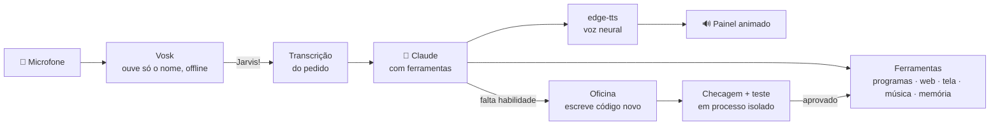

# 🎙️ Jarvis: assistente de voz que se melhora sozinho

Assistente de voz para Windows, em português. Fica ouvindo o microfone e, quando você diz **"Jarvis"**, entende o pedido, pensa com IA e **responde falando**.

Ele abre programas e sites, controla música e Spotify, olha a tela, transcreve áudios, lembra das coisas sobre você e passa tarefas maiores para o Claude Code. Quando falta uma habilidade, ele **escreve o próprio código**, testa num ambiente isolado e passa a usar.

---

## 🗣️ O que dá para pedir

- *"Jarvis, abre o Spotify e toca uma música calma."*
- *"Jarvis, o que tem nessa tela?"*
- *"Jarvis, transcreve o último áudio que eu baixei e resume a reunião."*
- *"Jarvis, me avisa daqui a 20 minutos."* (ele mesmo criou essa habilidade)
- *"Jarvis, lembra que a reunião de equipe é toda segunda às 10h."*
- *"Jarvis, usa o microfone do headset."* (ele ajusta a própria configuração)

## ⚙️ Como funciona



## ✨ Destaques técnicos

- **Auto-melhoria com sandbox:** o Jarvis escreve as próprias habilidades em Python. Antes de entrar no ar, cada código:
  1. passa por uma **checagem da árvore do código (AST)**: só importa funções de uma lista fechada, sem `open`, `exec`, `eval` ou `getattr`;
  2. roda num **processo isolado** (`python -I`) com um ajudante falso que só registra o que aconteceria;
  3. entra com backup, botão **"desfazer"** no painel e volta automática se quebrar.
- **Defesa contra prompt injection:** se a resposta usou conteúdo de um site ou da tela, ações sensíveis (mexer no próprio código, delegar ao Claude Code) são recusadas.
- **Ferramentas como servidor MCP** dentro do próprio processo, com sessão contínua pelo Claude Agent SDK.
- **Palavra de ativação offline:** o Vosk usa uma gramática restrita, então só a frase com o nome sai do computador.
- **Painel em Tkinter** com esfera animada e onda sonora sincronizada com a voz real.
- **Memória que se organiza sozinha** uma vez por dia, e ajustes por voz (microfone, silêncio, voz, velocidade).
- **Transcrição de áudio na placa de vídeo** com faster-whisper (CUDA, com volta automática para o processador).

## 🧰 Tecnologias

Python · Claude Agent SDK / API Anthropic · MCP · Vosk · Google Speech Recognition · edge-tts · faster-whisper · Tkinter · Win32 (ctypes)

## 🚀 Como rodar

1. Windows 10/11 com Python 3.12+:
   ```
   python -m venv .venv
   .venv\Scripts\pip install -r requirements.txt
   ```
2. Baixe o modelo Vosk pequeno em português (`vosk-model-small-pt-0.3`) em https://alphacephei.com/vosk/models e descompacte o conteúdo na pasta `modelo\` (ela deve conter `am`, `conf` etc.).
3. Copie `config.exemplo.json` para `config.json` e ajuste a voz, o microfone e a pasta de trabalho.
4. Escolha o "cérebro":
   - `"cerebro": "api"`: coloque sua chave em `anthropic_api_key`;
   - `"cerebro": "assinatura"`: faça login uma vez com o `claude.exe` que vem no `claude-agent-sdk`, usando `CLAUDE_CONFIG_DIR` apontando para a pasta `claude-assinatura\` do projeto.
5. Rode `Jarvis.bat` (painel + voz) ou `Jarvis (digitar).bat` (modo texto).

## 📁 Arquivos principais

| Arquivo | Para que serve |
|---|---|
| `jarvis.py` | Núcleo: ouvir, pensar, ferramentas, falar |
| `painel.py` | Painel flutuante animado |
| `claude_local.py` | Conexão com o Claude pelo Agent SDK |
| `oficina.py` · `regras.py` · `testar_habilidade.py` · `ajudante.py` | Auto-melhoria com checagem e sandbox |
| `consultor.py` | Consultoria diária (opcional) |
| `tarefeiro.py` | Delega tarefas grandes ao Claude Code |
| `transcrever.py` | Transcrição de áudio com faster-whisper |
| `habilidades/` | Habilidades criadas pelo próprio Jarvis |

## 📄 Licença

MIT
